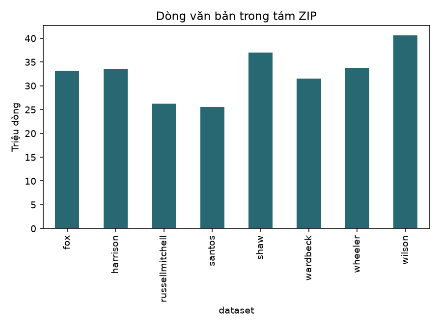
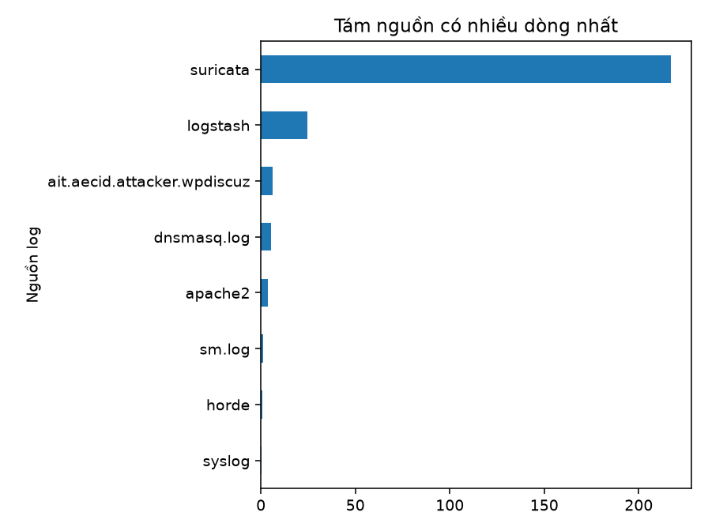
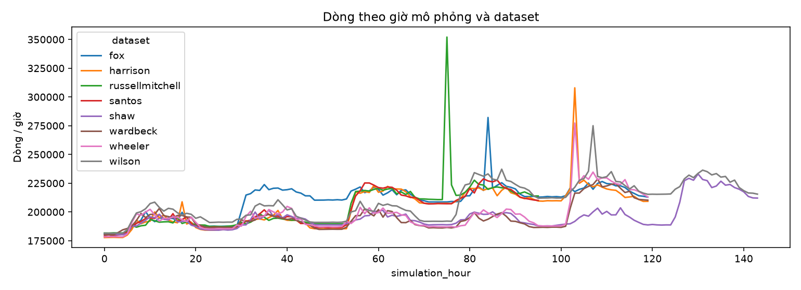
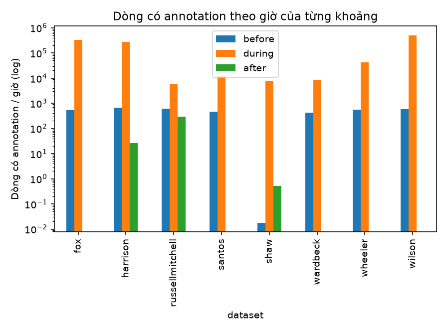

# EDA AIT Log Data Set v2.1 cho hành vi tài khoản

**Kết quả cho Team 2.** AIT-LDS phù hợp làm nguồn bổ trợ để khảo sát chuỗi xác thực và đối chiếu dấu vết trên host. Trong 222.664 dòng audit thuộc cửa sổ mô phỏng của tám testbed, 182.972 dòng có trường tài khoản và loại sự kiện bộ đọc sử dụng được (82,2%). Để kết luận một tài khoản cụ thể bị chiếm quyền, cần thêm bằng chứng xác nhận danh tính, vai trò và ranh giới sự cố.

Số liệu dưới đây dùng lần chạy **ait-v21-01**, tám ZIP khớp MD5 chính thức. Mặc định mỗi số đếm là dòng vật lý trong file văn bản thuộc `gather/<host>/logs/`. “Toàn file” gồm cả thời gian ngoài mô phỏng. Các phép đo theo thời gian dùng cửa sổ riêng của từng dataset, gồm biên đầu và loại biên cuối. [Notebook](../notebooks/ait_lds_eda.ipynb) · [Manifest và số đếm](../outputs/runs/ait-v21-01/manifest.json)

## Quy mô, nguồn và đơn vị

| Dataset | File thuộc phạm vi | Dòng văn bản toàn file | Dòng riêng có annotation toàn file | Dòng của năm nhóm nguồn trong cửa sổ |
|---|---:|---:|---:|---:|
| fox | 676 | 33.216.199 | 456.884 | 25.209.012 |
| harrison | 587 | 33.552.846 | 488.171 | 24.487.975 |
| russellmitchell | 503 | 26.263.657 | 61.862 | 19.504.557 |
| santos | 513 | 25.529.176 | 47.367 | 19.328.410 |
| shaw | 991 | 36.979.746 | 5.876 | 28.212.601 |
| wardbeck | 690 | 31.538.566 | 51.525 | 23.429.467 |
| wheeler | 708 | 33.705.629 | 491.082 | 23.711.203 |
| wilson | 815 | 40.617.166 | 494.125 | 30.165.058 |

Trong 5.483 file, bộ đọc đếm dòng trên 3.860 file và ghi kích thước của 1.623 file phân loại nhị phân qua phần mở rộng hoặc byte NUL đầu file. Tổng 261.402.985 dòng gồm cả các dòng định dạng bảng, tiêu đề và bộ đếm hệ thống. Riêng nhóm thư mục Suricata chiếm 217.031.623 dòng, khoảng 83,0% tổng lượng văn bản. Số dòng vì vậy nhạy với cách dịch vụ ghi log. Notebook mục 9–10 trình bày phân bố nguồn và phân vị số dòng theo host trong từng dataset.

## Thời gian và chất lượng

Đã áp dụng phép định giờ cho 225.191.589 dòng thuộc năm nhóm audit, auth, Suricata EVE, Suricata stats và Logstash. Trong mẫu số này, 194.048.283 dòng nằm trong mô phỏng, 28.077.729 dòng nằm ngoài và 3.065.577 dòng chưa xác định được giờ. 36.211.396 dòng văn bản thuộc các nguồn còn lại vẫn có trong tổng kiểm kê. Phân tích annotation có bộ đọc riêng cho các file đích được nêu ở phần nhãn.

Trong nhóm chưa xác định giờ, 3.065.521 dòng thuộc Logstash và 56 dòng thuộc Suricata stats. Bộ đọc Logstash tìm trường `@timestamp`, kết quả chưa xác định gồm các dòng ngoài định dạng hỗ trợ. Với Suricata stats, giờ của tiêu đề khối áp dụng cho những dòng bên dưới. Trong cửa sổ, nguồn này chiếm 165.479.548/194.048.283 dòng trên timeline. Do đó đỉnh biểu đồ chủ yếu phản ánh lượng dòng bộ đếm hệ thống. [Chi tiết theo dataset](../outputs/runs/ait-v21-01/time_quality.csv) · [Data Quality Log](../outputs/runs/ait-v21-01/quality_log.csv)

## Nhãn và thời điểm tấn công

Trên toàn bộ file annotation của tám archive, 2.096.892/2.096.892 annotation phân giải được tới đường dẫn và dòng nguồn. Kiểm tra tìm thấy 0 dòng annotation lỗi cấu trúc, 0 tham chiếu ngoài biên, 0 khóa dòng lặp trong một file nhãn. Mỗi dòng có nhiều nhãn, tổng cộng 6.284.252 lượt gán thuộc 22 giá trị nhãn. Các giá trị bao gồm nhãn tổng quát và nhãn chi tiết. Số bước thực thi và số sự cố độc lập cần ranh giới riêng. Pilot đối chiếu đúng nội dung bốn dòng theo ví dụ tác giả, còn kiểm tra toàn tập xác minh tính hợp lệ của tham chiếu.

So với cửa sổ tấn công công bố theo phút, 364.768 dòng có annotation xuất hiện trước, 1.726.001 dòng trong khoảng và 6.123 dòng sau khoảng. Mẫu số là toàn bộ 2.096.892 dòng có annotation, đối chiếu timestamp từng dòng. Trong số dòng có annotation trước cửa sổ, 364.756 thuộc DNS. Riêng russellmitchell có 46.346 trước, 9.808 trong và 5.708 sau. Dùng lịch để tạo lại nhãn sẽ làm thay đổi tập dòng dương tính. Nguyên nhân chênh lệch DNS chưa được xác minh độc lập. Cửa sổ công bố có độ phân giải phút và phép đếm loại biên cuối. Hình dùng số dòng có annotation chia số giờ của chính khoảng tương ứng. [Bảng số tuyệt đối](../outputs/runs/ait-v21-01/label_phase_summary.csv)

## Tài khoản, phiên và chuỗi

Trong các dòng audit có thời gian hợp lệ và nằm trong mô phỏng, trường `acct` cùng loại sự kiện cho phép theo dõi 166 nhóm dataset–host–tài khoản. Cả 166 nhóm có nhiều hơn một quan sát. Có 57.228/182.972 dòng nối được với mã phiên khác sentinel, tạo 19.097 tổ hợp dataset–host–acct–ses. Tổ hợp này mô tả phạm vi của mã phiên audit. Để xác nhận một phiên đăng nhập hoàn chỉnh còn cần kiểm tra biên mở, đóng và khả năng tái sử dụng mã.

Trong chuỗi theo cùng host–acct, có 66.903 cặp liền kề bằng timestamp. Bộ đếm bỏ các cặp bằng giờ và vẫn có độ bất định khi chọn phần tử đầu/cuối một cụm đồng thời. Cặp USER_ACCT → USER_AUTH xuất hiện 43.518 lần theo quy tắc này. Trong 182.686 dòng có lịch sử ở thời điểm sớm hơn, 315 dòng mang loại sự kiện lần đầu thấy trong lịch sử nhóm. Đây là số đo tính mới của **loại sự kiện audit** trong lịch sử 4–6 ngày. Tính mới của thiết bị và IP cần trường định danh cùng quy tắc nối khác. [Notebook, mục 12–14](../notebooks/ait_lds_eda.ipynb)

## Câu hỏi HKDN và giới hạn

| Câu hỏi | Mức trả lời | Căn cứ và giới hạn |
|---|---|---|
| Theo dõi được hoạt động xác thực của tài khoản trong một host? | Có trên phần có acct | Đo được số dòng, loại sự kiện, trật tự có điều kiện và lịch sử quan sát. Vai trò người thực hiện có thể khác tài khoản được nêu trong bản ghi. |
| Nối được cùng người qua host hoặc nguồn? | Một phần | Có thể mô tả đồng xuất hiện theo host và thời gian. Tên hoặc IP trùng cần căn cứ định danh trước khi gộp, đặc biệt giữa các testbed. |
| Phát hiện được bước nào để đối chiếu hồi cứu? | Có ở mức dòng có annotation | Nối được đường dẫn và số dòng, sau đó truy nhãn bước. Quy ước normal của tác giả trên phần còn lại vẫn phụ thuộc độ phủ rule. |
| Số sự cố chiếm tài khoản thực, tỷ lệ báo nhầm hoặc khả năng tổng quát hóa? | Chưa đủ dữ liệu | Nhãn tập trung vào bước tấn công mô phỏng. Chưa có tập sự cố tài khoản độc lập với kết luận danh tính và xác minh đầy đủ phần âm tính. |

Ở thời điểm chấm điểm chỉ có thể dùng các log đã đến và lịch sử trước sự kiện. Tên kịch bản, rule, annotation, lịch tấn công và kết quả điều tra chỉ phục vụ kiểm tra hồi cứu. Một số nguồn chứa log của chính tác nhân mô phỏng. Khi đánh giá khả năng dùng trường trong hệ thống thật, cần xét liệu phía phòng thủ có quan sát được nguồn đó. Kiểm tra lần này dừng ở dữ liệu và nhãn. [Đối chiếu với Survey](survey_report.md)
