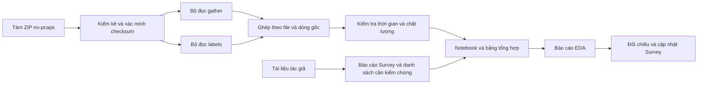

# Thiết kế lab | Survey & EDA AIT-LDS v2.1

**Trạng thái:** Thiết kế đề xuất. Các giao diện và mốc dưới đây mô tả công việc dự kiến. [Phạm vi và điều kiện hoàn tất](project_define.md)

## 1. System Architecture

## 2. Module

| Thành phần | Đầu vào | Đầu ra và quy tắc |
|---|---|---|
| Kiểm kê | Danh mục Zenodo, ZIP local | Manifest archive và thành viên gồm dataset, checksum, đường dẫn tương đối, host, loại file, byte nén và giải nén, trạng thái đọc. |
| Đọc log | Thành viên ZIP, cấu hình định dạng | Đánh số dòng vật lý từ 1 trước mọi lọc hoặc parse. Sự kiện nhiều dòng giữ tham chiếu tới các dòng cấu thành. Ghi timestamp nguồn, trạng thái parse, offset và căn cứ chuyển đổi. |
| Đọc và ghép nhãn | Annotation và chỉ mục dòng gốc | Thay tiền tố labels bằng gather, giữ nguyên toàn bộ đường dẫn tương đối kể cả tên rotation. Khóa ghép gồm dataset, đường dẫn nguồn, số dòng. Giữ danh sách nhãn và quy tắc nguồn. |
| Kiểm tra và tổng hợp | Dòng, annotation, khoảng mô phỏng của từng dataset | Bảng kiểm tra thiếu, lỗi, trùng và bao phủ. Phân loại thời gian thành trong, ngoài hoặc chưa xác định trước khi lập timeline. Ghi cách xử lý hai biên thời gian. |
| Notebook và báo cáo | Bảng đã bảo vệ, manifest, cấu hình | Bảng, hình, nhận xét và tham chiếu run. Ma trận bằng chứng nối lời công bố với phép đo và trạng thái khớp, khớp một phần, khác hoặc chưa thể kiểm tra. |

## 3. Folder Structure

| Đường dẫn | Trách nhiệm |
|---|---|
| `docs/` | Đặc tả, thiết kế và hai báo cáo Survey, EDA khi có kết quả. |
| `reference/` | Tài liệu tham khảo cục bộ của HKDN, Lab 2 và AIT. |
| `configs/` | Danh mục đầu vào và tham số có thể chia sẻ. |
| `data/{archives,extracted,cache,scratch}/` | ZIP gốc, file cần trích, dữ liệu trung gian và file tạm trên máy. |
| `src/ait_lds_survey_eda/readers/` | Bộ đọc theo định dạng. Package cha chứa kiểm kê, ghép nhãn, thời gian và phép đo. |
| `scripts/` | Điểm chạy pipeline và notebook. |
| `notebooks/` | Notebook EDA chính. |
| `tests/fixtures/` | Tình huống tổng hợp nhỏ cho gather và labels. |
| `outputs/runs/<run_id>/` | Manifest, inventory, quality, tables, figures, logs và notebook đã chạy của lần đo. |

## 4. Data Flow

Với mỗi archive, kiểm tra checksum, đọc danh mục file và lấy cửa sổ mô phỏng từ `dataset.yml`. Đọc `gather/` theo thứ tự vật lý, lập khóa dòng trước khi lọc. Nối annotation từ `labels/` vào khóa này để kiểm tra tham chiếu trên toàn file. Sau đó chọn sự kiện trong cửa sổ cho phân tích thời gian và thống kê riêng nhóm ngoài cửa sổ hoặc thiếu thời gian. Notebook đọc bảng tổng hợp của cùng lần chạy để tạo hình và báo cáo EDA.

Ưu tiên đọc tuần tự thành viên ZIP. Trước khi giải nén, so dung lượng trống với kích thước các thành viên cần dùng và dung lượng đầu ra dự kiến. Python và Jupyter là phương án đề xuất. Chọn định dạng cache sau khi đo dung lượng, bộ nhớ và thời gian trên một archive.

Tách nhãn và nhật ký điều phối khỏi bảng tín hiệu hành vi. Chỉ xét lịch sử đã khả dụng tại thời điểm quan sát. Thiếu bằng chứng về timezone, tài khoản, phiên hoặc thời điểm khả dụng thì giữ trạng thái chưa xác định. Tránh ghép danh tính xuyên testbed chỉ vì trùng tên. Notebook chia sẻ dùng thống kê tổng hợp. Đường dẫn nguồn chi tiết phục vụ truy vết trong manifest cục bộ. Chỉ ghi mã lỗi và số đếm vào log chạy.

## 5. Interface

| Giao diện đề xuất | Kết quả và điều kiện kiểm tra |
|---|---|
| `inventory(archive, expected_checksum)` | Trả bảng thành viên kèm trạng thái toàn vẹn. Khi checksum sai, ghi lỗi và dừng xử lý archive đó. |
| `iter_lines(member)` | Trả từng cặp số dòng và nội dung theo thứ tự nguồn, tính cả dòng trống. Nội dung thô chỉ dùng trong bộ đọc cục bộ. |
| `resolve_label(dataset, path, line)` | Trả tham chiếu dòng hoặc lý do ghép lỗi. Hai file trùng tên ở hai host có khóa riêng. |
| `classify_time(timestamp, simulation_window)` | Trả trạng thái trong khoảng, ngoài khoảng hoặc chưa xác định, kèm căn cứ về múi giờ. |

## 6. Track

Theo dõi từng mốc bằng trạng thái dự kiến, đang thực hiện hoặc đã nghiệm thu. Chỉ chuyển sang đã nghiệm thu khi có artifact đối chiếu được. Với mỗi khẳng định Survey, ghi nguồn, phép kiểm, `run_id`, bảng kết quả và kết luận đối chiếu. Các phép đo sau dùng để theo dõi độ phủ và giải trình sai lệch.

- Tỷ lệ ghép nhãn lấy số annotation phân giải đúng một dòng nguồn chia cho tổng annotation trong phạm vi. Báo riêng lỗi đọc annotation, thiếu file, số dòng ngoài phạm vi và annotation trùng. Một dòng có nhiều nhãn hợp lệ vẫn chỉ đóng góp một dòng vào số dòng có nhãn.
- Đối chiếu ví dụ của tác giả với đúng dòng nguồn để kiểm tra lệch một dòng. File log thiếu file nhãn được thống kê riêng. Ghi cách tác giả diễn giải dòng không có annotation sau khi ghép thành công và giới hạn xác minh hành vi lành tính.
- Với mỗi nguồn, đối chiếu tổng dòng kiểm kê với số dòng xử lý, bỏ qua có lý do và lỗi theo nhóm loại trừ nhau. Đối soát riêng số sự kiện logic. Tỷ lệ thiếu trường dùng số bản ghi mà trường đó áp dụng làm mẫu số.
- Vẽ lượng log theo dataset, host, nguồn, thời gian và trước–trong–sau khoảng tấn công. Ghi độ dài cửa sổ, dùng tốc độ trên đơn vị thời gian khi so cửa sổ khác độ dài. Chỉ tính hồ sơ tài khoản và chuỗi trên phần nối được, báo tỷ lệ bao phủ.
- Mỗi run lưu phiên bản đầu vào, mã nguồn, môi trường, cấu hình, tổng số và kết quả kiểm tra. Data Quality Log ghi vấn đề, số lượng, quyết định, lý do và số dòng chịu ảnh hưởng.

## 7. Milestone

| Mốc | Bằng chứng cần có trước khi chuyển tiếp |
|---|---|
| Survey tài liệu | Báo cáo sơ bộ, danh mục tám ZIP, câu hỏi và ma trận cần kiểm chứng. |
| Thử bộ đọc | Fixture có dòng trống, dòng lỗi, nhiều nhãn, rotation, tham chiếu sai và timestamp mơ hồ. So kết quả mong đợi với một lần chạy thử trên một archive. |
| Kiểm kê toàn bộ | Cùng phiên bản bộ đọc và cấu hình áp dụng cho tám archive. Mỗi ngoại lệ có số lượng và ảnh hưởng. |
| EDA và nghiệm thu | Chạy lại notebook từ đầu, đối chiếu bảng và hình với run manifest, truy vết một phát hiện từ báo cáo về nguồn. Ghi rõ câu hỏi chưa đủ bằng chứng. |

Áp dụng cách nghiệm thu của Lab 2 cho từng bộ đọc và phép ghép quan trọng. Đặc tả đầu vào, đầu ra và trường hợp biên trước khi lập trình. Sau khi review, chạy thử và kiểm thử, mọi sửa đổi ảnh hưởng số đếm cần được kiểm tra hồi quy.

## 8. Technical Risk

| Rủi ro | Cách phát hiện và xử lý |
|---|---|
| Lọc dòng trống hoặc dòng lỗi làm lệch nhãn | Kiểm thử bằng fixture có nhãn ngay sau dòng lỗi. Đối chiếu số dòng với ví dụ của tác giả trước khi chạy toàn bộ. |
| Timestamp thiếu năm hoặc offset làm sai thứ tự liên host | Giữ giá trị gốc và căn cứ tái dựng. Tách các sự kiện có thời gian chưa xác định khỏi phân tích thứ tự. |
| Nhiều nhãn hoặc nhiều log của một thao tác làm tăng số ca | Báo riêng từng đơn vị đếm. Chỉ đếm ca khi xác định được ranh giới từ nguồn. |
| Lịch tấn công và kết quả hậu nghiệm làm lộ nhãn | Chỉ dùng những trường này khi đối chiếu hồi cứu. Ghi rõ thời điểm khả dụng của từng tín hiệu hành vi. |
| ZIP lớn hoặc cache cũ làm lần chạy thiếu dữ liệu | Đọc theo khối, kiểm tra dung lượng và gắn cache với checksum đầu vào cùng phiên bản bộ đọc. |
